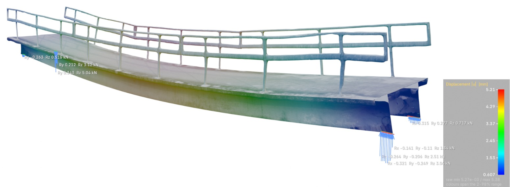
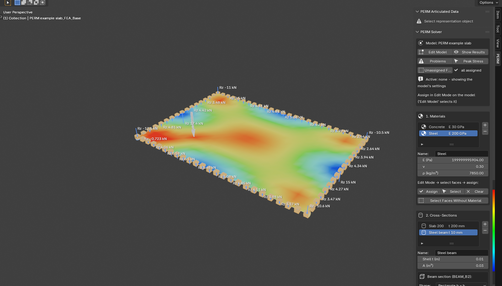
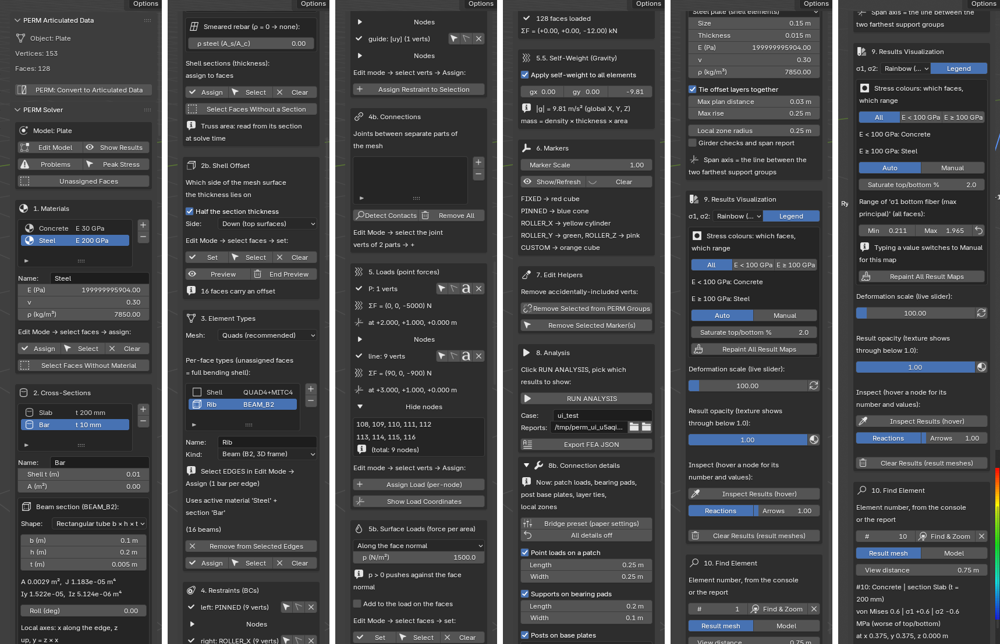

# PERM — Physics-Encoded Reality Modeling
PERM is a Blender add-on that runs a linear static finite element analysis directly on a surface mesh:
a reality-captured mesh (LiDAR, photogrammetry), a CAD export, or a mesh modelled in Blender. Materials,
thicknesses, supports, and loads are assigned to the mesh in Blender's own Edit Mode, the model is solved inside
Blender, and displacements, stresses and reactions are drawn on the mesh and written to a text report.

The whole add-on is one file, [`perm.py`](perm.py).



*A fused LiDAR and photogrammetry mesh of a precast girder bridge, analysed with PERM: displacement magnitude
(mm) under three 20 kN point loads (deformation exaggerated) and the support reactions on the bearing pads.*



## What it does

| | |
|---|---|
| Shell elements | QUAD4: QM6 incompatible-mode membrane + MITC4 plate bending and shear + drilling rotation (6 DOF per node). TRI3: CST membrane + MITC3 bending and shear + drilling rotation. |
| Line elements | TRUSS_T2 (axial bar) and BEAM_B2 (3D Timoshenko beam) on mesh edges, with or without faces. |
| Per-face options | Material, thickness (cross-section), element type (full shell, membrane only, plate only), shell offset (thickness on one side of the mesh surface), smeared reinforcement (linear transformed section). |
| Supports | Fixed, pinned, roller along X, Y or Z, or any set of the six degrees of freedom (custom). |
| Loads | Point forces on vertices, surface loads on faces (per area, in a global direction or along the face normal), self-weight with a free acceleration vector. |
| Connections | Fixed, pinned and hinged joints between separate parts of one mesh, with automatic contact detection. |
| Results | Deformed shape, von Mises, principal and Cartesian stresses at the top and bottom fibre, bending moments, support reactions; hover inspector; text report and CSV log per analysis; JSON export of the model as analysed. |
| Bridge details (optional) | Loading patches, bearing pads, post base plates, ties between offset layers, girder checks. Off for a new model; one button sets the values used in the paper. |

The analysis is **linear elastic, static, small displacements**. There is no dynamic, buckling or nonlinear
analysis in the add-on.

## Requirements

- Blender **4.2 LTS or newer**. Tested on the versions listed in [docs/VERIFICATION.md](docs/VERIFICATION.md).
- **SciPy**. Blender ships NumPy but not SciPy. The PERM panel shows an **Install SciPy** button when it is
  missing (see below).

## Install

1. Download `perm.py`.
2. Blender: *Edit > Preferences > Add-ons >* arrow at the top right *> Install from Disk…*, pick `perm.py`, and
   tick the add-on to enable it.
3. In the 3D Viewport press `N` and open the **PERM** tab.

Only one PERM can be registered in a Blender session. If an older version is enabled as an add-on, or a .blend
file runs an older `perm_v*.py` text block, disable or remove that one first.

### SciPy

If the panel says *SciPy is not installed*:

1. Allow online access: *Edit > Preferences > System > Network > Allow Online Access*.
2. Click **Install SciPy** in the PERM panel. Blender waits while pip downloads it (about 40 MB).

The button runs this command with Blender's own Python and installs into Blender's user `scripts/modules`
folder, which needs no administrator rights:

```
<blender python> -m pip install --upgrade --target <user scripts>/modules scipy numpy==<Blender's NumPy version>
```

NumPy is pinned to the version Blender ships so that pip picks a SciPy built for it; the extra NumPy copy pip
places next to SciPy is removed again, so Blender keeps using its own. The exact command is printed in the
system console (*Window > Toggle System Console* on Windows), in case you need to run it by hand, for example
behind a proxy.

## Quick start

A complete example can be built with `examples/example_plate.py` (*Scripting* workspace *> Open > Run Script*).
By hand, on any mesh object:

1. **Materials** — `+`, set E (Pa), ν, density (kg/m³). Edit Mode, select faces, **Assign**.
2. **Cross-Sections** — `+`, set the thickness (m). Edit Mode, select faces, **Assign**.
3. **Restraints** — Edit Mode, select vertices, **Assign Restraint to Selection**, choose the type.
4. **Loads** — point forces: select vertices, **Assign Load (per-node)**. Surface loads: select faces, set the
   value in *5b. Surface Loads*, **Set**. Self-weight: tick it in *5.5*.
5. **RUN ANALYSIS**, tick the result maps you want.
6. Read the results: the maps appear as separate objects, the report is saved in the folder shown in
   *8. Analysis*, and **Inspect Results (hover)** shows the values under the mouse.

The full description of every section and every command is in [docs/USER_GUIDE.md](docs/USER_GUIDE.md).



## Units and conventions

- SI units throughout: **m, N, Pa, kg**. One Blender unit is one metre. Results are reported in mm, kN, kN·m and MPa.
- The model is read in **world coordinates**: object location, rotation and scale are taken into account. A
  mesh drawn in millimetres can be used by scaling the object by 0.001 (the scale need not be applied).
- Keep the scene's *Unit Scale* at 1 (the default). PERM reads one Blender unit as 1 m whatever the scene
  units show, and says so in the panel when they differ.
- Global Z is up for the options that speak of top, bottom and vertical (shell offset *Down/Up*, the bridge details).
  Self-weight acts along the acceleration vector you enter (default 0, 0, −9.81).
- Top = the side the face normal points to. The maps of the Cartesian stress components and moments use the
  global axes; the JSON export lists the components in each element's local axes. Von Mises and principal
  stresses do not depend on the axes.
- Blender stores panel numbers in single precision, so 2e11 is displayed as 199999995904.

## Any surface mesh

- Quads and triangles are analysed as they are, or converted (*3. Element Types > Mesh*: *Quads* joins
  triangle pairs into quads where it can; *Triangles* splits every face).
- With *Quads*, faces with more than four vertices produce **no element**. PERM warns and **Problems** selects
  them; triangulate them (Ctrl+T) first, or use *Triangles*.
- The analysis runs on a cleaned working copy: vertices closer than 0.1 mm are merged, degenerate faces and
  loose vertices are removed, normals are made consistent. The mesh you assign on is not changed.
- Separate parts are connected only where their vertices coincide (within 0.1 mm, by the merge above) or where
  you add a connection (*4b. Connections > Detect Contacts*). A part whose edge ends on the middle of another
  part's face is not connected to it.
- Accuracy depends on the mesh, as in any finite element analysis: element size, aspect ratio and distortion
  matter. **Problems** selects folded and strongly warped faces.

## Bridge preset

PERM was developed on a reality-captured model of a precast girder bridge (see *How to cite*). Four connection
details and a set of girder checks from that study are options in *8b. Connection details*; all are **off for a
new model**. **Bridge preset (paper settings)** switches them on with the paper's values:

| Option | Preset |
|---|---|
| Point loads on a patch | 0.25 m × 0.25 m |
| Supports on bearing pads | 0.20 m along the span × 0.10 m across |
| Posts on base plates | steel plate of shell elements, 0.15 m square, 15 mm thick, E 200 GPa, ν 0.3, 7850 kg/m³ |
| Tie offset layers together | plan distance ≤ 0.03 m, rise ≤ 0.25 m |
| Local zone radius | 0.25 m |
| Girder checks and span report | on |

A model made with PERM v27–v31 had these details always on. Click the preset once in such a file to
reproduce its earlier results.

## Verification

`tests/` holds three test scripts that drive PERM through the same commands the panel calls:

- `test_commands.py` runs every command on generic meshes (plates, a curved shell, two joined parts, Blender's
  monkey, spheres, a torus, a cone, a scaled and rotated box).
- `test_benchmarks.py` compares PERM with closed-form and published reference solutions.
- `test_ui.py` installs the add-on from disk, draws the panel in each state, opens every dialog and runs the
  hover inspector.

Results, tolerances and the Blender versions they were run on are in
[docs/VERIFICATION.md](docs/VERIFICATION.md); how to run them is in [tests/README.md](tests/README.md).

Check the results of your own model against an independent calculation before relying on them.

## Limitations

- Linear elastic, static, small displacements.
- The linear solver is SciPy's sparse direct solver (SuperLU). Memory grows faster than the model: meshes of
  about 160 000 faces (about 940 000 degrees of freedom) were solved on a Windows PC with 32 GB of memory in
  about 10 minutes each (the solve alone), but did not fit in the 5.8 GB test machine used for
  [docs/VERIFICATION.md](docs/VERIFICATION.md).
- Supports and custom restraints act along the global axes. Prescribed non-zero displacements are in the solver
  but not in the panel.
- Surface loads are per unit of the face's own area (not per projected area) and are stored as vectors when
  set: after rotating the object or flipping normals, set a pressure again.
- One surface-load vector per face (a new value replaces or is added to the old one).
- The *PERM Articulated Data* panel converts a mesh to TRI3, TRI6, QUAD4 or QUAD8 and can export nodes,
  elements, node sets and materials to Abaqus `.inp`, Nastran `.bdf` or JSON. It is a mesh export: sections,
  supports and loads of the solver panel are not in those files (use *Export FEA JSON* for the analysed model).
  The solver itself uses QUAD4 and TRI3; it gives TRI6 and QUAD8 membrane stiffness only.
- The bridge details assume Z up and a span axis through the two farthest support groups.

## Files

```
perm.py                 the add-on
docs/USER_GUIDE.md      every panel section and every command
docs/VERIFICATION.md    test results
examples/               a script that builds a ready-to-run example
tests/                  the test scripts
CHANGELOG.md            what changed in each version
CITATION.cff            how to cite
LICENSE                 GNU General Public License v3
```

## How to cite

S. Nuraliyev and F. Luleci, "Physics-encoded reality modeling for structural analysis of textured infrastructure meshes," manuscript in preparation, 2026.

The reference will be updated when the paper is published. See also `CITATION.cff`.

## License

PERM is free software under the **GNU General Public License, version 3 or later** (see [LICENSE](LICENSE)).
Blender's licence page states that scripts using the Blender Python API, if published, are to be shared under a
GPL-compliant licence: <https://www.blender.org/about/license/>.

Copyright (C) 2026 Sadig Nuraliyev and Furkan Luleci, Department of Civil and Environmental Engineering,
Louisiana State University.
