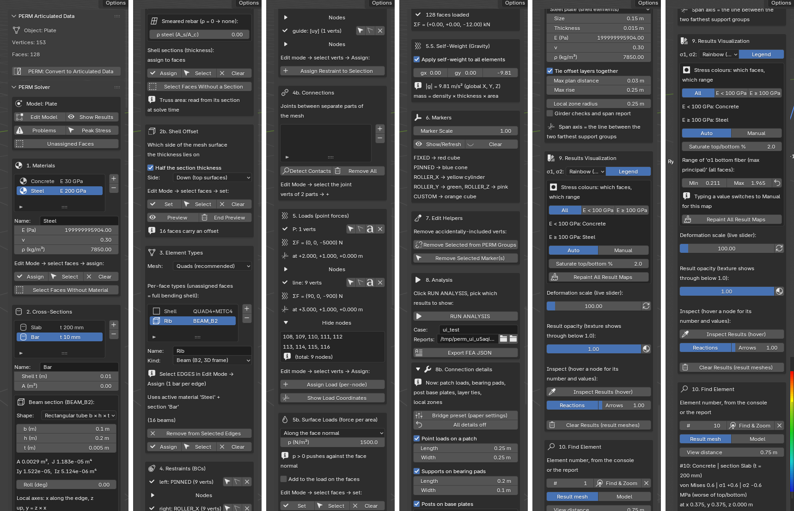

# PERM user guide

The panel is in the 3D Viewport sidebar (`N`), tab **PERM**. Its sections are numbered in the order of a normal
session; this guide follows the same order. Every button has a tooltip.

Units are SI: **m, N, Pa, kg**. One Blender unit is one metre, whatever the scene's unit settings display; keep
*Scene Properties > Units > Unit Scale* at 1. If it is not, the panel shows a red note. A mesh drawn in another
unit is brought to metres by scaling the object (millimetres: scale 0.001); the scale need not be applied.

If SciPy is missing, the panel starts with a red box and the **Install SciPy** button (see the README).



## The model, the working copy and the result meshes

- **The model** is the mesh object you select. Everything you assign is stored on it: face attributes for
  materials, sections, element types, shell offsets and surface loads; vertex groups for supports and point
  loads; custom properties for their values.
- At each analysis PERM makes a **working copy**, cleans it (merges vertices closer than 0.1 mm, removes
  degenerate faces and loose vertices, makes the normals consistent), converts its faces to quads or triangles
  and builds the finite element model from it in world coordinates. Your mesh is not changed.
- Each result map is a **separate mesh object**. After an analysis the model is hidden and the results are
  shown. **Edit Model** shows and selects the model again; **Show Results** goes back to the results;
  **Clear Results** deletes the result meshes and the working copy.
- Assignments made on a result mesh would never reach the analysis, so PERM refuses them and tells you to click
  **Edit Model**.
- **Convert to Articulated Data** (a separate panel, see the end of this guide) also makes a copy,
  `<model>_FEA_Base`, but it hides your model and leaves the copy **visible and selected**. PERM treats the
  selected mesh as the model, so assignments and analyses would then go to the copy. Delete the copy, then show
  and select your model in the Outliner; **Edit Model** does not switch back from this copy.

At the top of the panel:

| Button | What it does |
|---|---|
| Edit Model / Show Results | Switch between the model and its result meshes. |
| Problems | Selects folded or inverted quads, faces with more than four vertices, strongly warped quads and faces without a section or material. A dialog lets you choose which. |
| Peak Stress | Selects the faces with the highest von Mises stress of the last analysis. |
| Unassigned Faces | Selects the faces without a cross-section or material and shows how many there are. |

## 1. Materials

`+` adds a material: Young's modulus E (Pa), Poisson's ratio ν, density (kg/m³). In Edit Mode select faces and
click **Assign**. **Select** selects the faces of the active material; **Clear** removes it from all its faces.

Faces without a material use the first material in the list, and PERM warns about it at each analysis.

A material with density 0 has no weight; use it for parts that only link others.

## 2. Cross-Sections

`+` adds a cross-section. For shell faces only the **thickness** matters. Assign it to faces as for materials.
Faces without a section use a default thickness of 0.30 m, with a warning.

The same list holds the sections of bars on edges:

- **Truss bars** use the area *A*.
- **Beams** use a shape (rectangle, rectangular tube, circle, circular tube) with its dimensions, or *Generic*
  with A, Iy, Iz, J, a shear factor and the fibre distances for the stresses. Local axes: x along the edge;
  z is global Z projected on the plane normal to the member (global X for a vertical member); y = z × x.
  *Roll* turns the section about the member.

**Smeared rebar** (ρ > 0) adds reinforcement to a shell section as a linear transformed section: ratio
A_s/(b·t) summed over both layers, distance from the face to the bar centre, steel modulus. With ρ = 0 the
section is plain.

## 2b. Shell Offset

A shell element puts half of its thickness on each side of the mesh surface. When the mesh is the outer
surface of a member (a scanned slab top, a soffit), set an offset so that the whole thickness lies on one side:

- **Half the section thickness** (default) or a typed distance.
- **Side**: *Down* (the mesh is a top surface), *Up* (an underside), *Against* or *Along* the face normal.
- Edit Mode, select faces, **Set**. **Select** shows the faces that carry an offset, **Clear** removes it.
- **Preview** draws the thickness as solids, with and without the offset; **End Preview** removes them.

The vertices are not moved. *Down* and *Up* need faces that are not vertical.

## 3. Element Types

**Mesh** chooses what the faces are converted to before the analysis:

- *Quads*: quads stay quads, triangle pairs are joined into quads where their shape allows, the rest stay
  triangles. Faces with more than four vertices give **no element** in this mode: PERM warns, **Problems**
  selects them, and Ctrl+T triangulates them.
- *Triangles*: every face is split into triangles, faces with more than four vertices included. Triangles are
  less accurate than quads on the same mesh.

**Per-face types** are optional. A face without one is a full bending shell.

| Kind | Use |
|---|---|
| Bending shell (QUAD4) | The default: membrane + bending + transverse shear + drilling. |
| Membrane shell (QUAD4) | In-plane stiffness only; a hinge out of plane. |
| Plate, MITC4 only (QUAD4) | Bending only, no in-plane stiffness. For flat plates under transverse load. |
| Triangle shell (TRI3) | The triangle element, for faces that are triangles. |
| Truss bar (T2) | An axial bar on each selected **edge**. |
| Beam (B2, 3D frame) | A Timoshenko beam on each selected **edge**. |

For a truss or beam: pick the material and the cross-section in sections 1 and 2 (the bar uses the active
ones), select edges in Edit Mode and click **Assign**. Edges without faces work too, so a frame can be a mesh of
edges only. **Remove from Selected Edges** removes bars; **Clear** removes the active type everywhere.

## 4. Restraints

Edit Mode, select vertices, **Assign Restraint to Selection**, give a name and a type:

| Type | Fixed |
|---|---|
| FIXED | ux, uy, uz, rx, ry, rz |
| PINNED | ux, uy, uz |
| ROLLER X / Y / Z | the two translations other than the named axis |
| CUSTOM | the degrees of freedom you tick |

Axes are the global axes. Examples for CUSTOM: a simple support of a plate edge is `uz`; a symmetry plane with
normal X is `ux, ry, rz`; with normal Y it is `uy, rx, rz`.

Each group is listed with buttons to select, deselect and remove it, and a foldable list of its vertices.
The model needs enough restraints to prevent rigid-body motion (at least six restrained degrees of freedom,
suitably placed); otherwise the solver reports it or gives very large displacements.

Bearing pads are not a restraint type. Keep PINNED or ROLLER on the bearing vertices (8 or fewer per group) and
switch on **Supports on bearing pads** in 8b: at the analysis each of those vertices becomes a pad.

## 4b. Connections

A connection joins two **separate parts** of the same mesh object: parts that share no vertices. Two pieces
that are linked anywhere, even through other faces, are one part. A railing post, for example, is in the same
part as the deck as long as any post of its railing shares vertices with the deck, so cutting one post at its
base does not make it a separate part.

**Making separate parts.** Where the mesh is continuous, cut it first: in Edit Mode select the faces of one side
and press `Y` (*Mesh > Split > Selection*). The selected faces get their own copy of the vertices along the cut,
so the two sides touch but share nothing. To cut a whole railing from a deck, select all railing faces
(1. Materials: click the railing material, **Select**) and split; every post base then becomes a cut. A split
can renumber all the vertices (see 5. Loads), so cut **before** you assign point loads.

Then add the connections:

- **Detect Contacts** finds where parts come within the tolerance (default 5 mm) of each other, the coincident
  vertices of a cut included, and adds one connection per contact zone (one per post base after a railing is
  split off).
- By hand: Edit Mode, select the joint vertices of both parts, `+`. With X-ray on (`Alt+Z`) a box selection
  across a cut takes both copies of its vertices. The message gives the number of vertices on side A and on
  side B; both must be above zero.

| Type | Transmits |
|---|---|
| FIXED | forces and moments (rigid) |
| PINNED | forces only, through the joint centre |
| HINGE | everything except the moment about the hinge axis |

**Hinge axis.** *Along the joint* is the direction in which the joint vertices are spread; it suits a joint
along a line (a hinge line). For a compact joint, such as the ring of vertices around a post base, it is only
their main direction and has no physical meaning, and PERM prints a note: pick *Global X*, *Y* or *Z*. A joint
that is a single point has no direction and is treated as PINNED, with a warning.

**Mechanisms.** Pinned joints that lie on one line, or hinges whose axes lie on one line, let the part turn
about that line. A railing panel whose post bases are all pinned, or all hinged about the line through them,
can tip over. The report lists the force and moment each joint carries, and warns when a pinned or hinged joint turns
so much that a part is probably a mechanism.

**Apply this type to all joints** copies the active joint's type (and hinge axis) to every joint.
**Select / Side A / Side B** select the vertices of the active joint.

**Coincident vertices.** The clean-up merges vertices closer than 0.1 mm. Parts that touch at coincident
vertices and have **no** connection are therefore joined rigidly, as one continuous mesh, and need no
connection. A FIXED connection keeps the merged nodes. For a PINNED or HINGE connection PERM separates the
merged nodes again by part before the analysis (the console gives the number of shared nodes split); if both
sides of such a connection lie in the same part, it is skipped, with a warning.

**Posts on base plates (8b).** A post with a connection at its base gets no base plate: the connection replaces
it. Concrete faces thinner than 2 cm under such a post (see 8b) are then analysed at that thickness; give them
the section and shell offset of the deck around them.

## 5. Loads (point forces)

Edit Mode, select vertices, **Assign Load (per-node)**: every selected vertex gets the forces Fx, Fy, Fz (N) you
type, so the group's total is the value times the number of vertices. The panel shows the total and where the
resultant acts. The `a` button opens a table to give each vertex its own force. **Show Load Coordinates** writes
the positions to the console and to the text block `PERM_Loads.txt`.

**A load on a patch.** With *Point loads on a patch* on (8b), a group of 1 to 3 vertices is spread over the
faces of the patch around it; a group of more vertices stays on its vertices. For a wheel or patch load select
**one** vertex and type the whole force (−20000 N for 20 kN): the value is per vertex, so a selection of
several vertices multiplies it. At the analysis the console says how many nodes and how much face area the
patch loaded, or that no face qualified and the load was left on its node(s).

**Selecting a vertex at given coordinates.** In Edit Mode, *N > Item > Vertex* shows the coordinates of the
selected vertex; click **Global** to read world coordinates (*Local* uses the object's own axes, which differ
when the object is rotated). To select the vertex nearest to a point, select the model in Object Mode, paste
into the Python Console (*Scripting* workspace) with your coordinates, then press `Tab` over the 3D Viewport:

```python
from mathutils import Vector
me = C.object.data; M = C.object.matrix_world; t = Vector((2.0, 1.0, 0.5))
i = min(range(len(me.vertices)), key=lambda k: (M @ me.vertices[k].co - t).length); print(i, M @ me.vertices[i].co)
junk = [setattr(x, "select", False) for c in (me.vertices, me.edges, me.polygons) for x in c]
me.vertices[i].select = True
```

It is the nearest vertex in 3D: check that it lies on the surface you want to load.

**Vertex numbers.** A load group is stored with its vertices, but the forces typed for them are stored by
vertex **number**. A mesh edit after the load was assigned (split, merge, delete, separate, remesh) can
renumber the vertices: the group still follows its vertices, while the stored forces stay with the old
numbers, which now belong to other vertices. Without patch loads the forces are then applied at those other
vertices. **Show Load Coordinates** lists every vertex of each group with its force; a vertex with
F = (0, 0, 0) in a group that should carry a load means the numbers have changed: remove the load (`X`) and
assign it again. Assign point loads after the last mesh edit.

**Where the load acts along the span.** On assignment and with **Show Load Coordinates**, a, b and a/L are
measured from the centres of the support groups as assigned. With *Supports on bearing pads* on (8b), the
report measures them from the pad centres, so the two differ by about half a pad length (about 0.10 m with
the bridge preset).

## 5b. Surface Loads

A force per unit area on faces:

- **Global direction**: components qx, qy, qz in N/m² (1 kN/m² = 1000). A floor load of 5 kN/m² is (0, 0, −5000).
- **Along the face normal**: a pressure p in N/m². Positive pushes against the normal, that is onto the side
  the normal points out of (the blue side in *Overlays > Face Orientation*); negative is suction.

Edit Mode, select faces, **Set**. *Add to the load on the faces* adds to what the faces already carry instead of
replacing it. **Select** selects the loaded faces, **Clear** removes the load from the selected faces. The panel
shows the number of loaded faces and the resultant.

The force on a face is the value times the face's own area (not its projected area). The load is stored as a
vector per face when it is set: if you rotate the object or flip normals afterwards, set a pressure again.

Surface loads are not the patch load. *Point loads on a patch* (8b) spreads a point load of section 5 over a
patch; it does not use this section. If both are set, both act.

## 5.5 Self-Weight

Tick **Apply self-weight to all elements**. The weight is density × thickness × area (bars: density × area ×
length) times the acceleration (gx, gy, gz), default (0, 0, −9.81) m/s². Untick it for a case with the applied
loads only. The RUN ANALYSIS dialog takes self-weight, loads and supports from the panel; it only chooses the
result maps.

## 6. Markers and 7. Edit Helpers

**Show/Refresh** draws a marker at every restrained and loaded vertex; the colours are listed in the panel.
**Remove Selected from PERM Groups** takes the selected vertices out of every support and load group;
**Remove Selected Marker(s)** does the same for the vertices of the selected marker objects.

## 8. Analysis

- **Case**: a name for this run, used for the report file.
- **Reports**: the folder for the reports (`//` is next to the .blend file; an unsaved file uses
  `~/PERM_results`).
- **RUN ANALYSIS** opens a list of result maps; tick the ones you want and confirm.
- **Export FEA JSON** writes the model as analysed (nodes, elements with material, thickness and offset,
  supports, each load case as nodal forces, optionally all results) to a JSON file.

Each analysis writes a text report (materials, mass, supports and reactions, loads, displacements, stress
extremes per material, equilibrium checks, bars and connections) and adds one line to `PERM_results_log.csv`.
The report is also in the Text Editor as `PERM_Results.txt`.

Read the console (*Window > Toggle System Console* on Windows) after the first run of a model: PERM lists the
materials and thicknesses it used, the mass, the supports and every warning.

## 8b. Connection details

Options that refine how loads and supports meet the mesh. They come from the girder-bridge study and are
**off for a new model**. Click the small arrow to open the section.

| Option | What it does |
|---|---|
| Point loads on a patch | A point load (a group of 1 to 3 vertices) is spread over the faces around it, within a rectangle of the given length (along the span axis) and width, centred on the load's vertices. Only faces whose centre lies in the rectangle, within 3 cm in height, less than 45° from horizontal, of a material with E < 100 GPa and mass are loaded, each in proportion to its area. Faces that are only displayed and the deck fill PERM builds under a post (*Posts on base plates*) are not loaded. A group of more than 3 vertices stays on its vertices. This is not a surface load (5b). |
| Supports on bearing pads | Each vertex of a PINNED or ROLLER group (8 vertices or fewer; two support groups or more) becomes a pad of the given length and width at its height: the vertices within 8 mm in height, from the support vertex towards the other support (length) and within half the width plus 1 cm across. The pad is held as a whole, so it can rotate; PINNED or ROLLER carries over to it. The report then lists the pad nodes and measures the span from the pad centres. Pads are set here, not in 4. Restraints. |
| Posts on base plates | Where faces of a material with E ≥ 100 GPa meet faces of a softer one, the post stands on a base plate: a plate of shell elements with the given size, thickness and material, or a rigid plate. Concrete faces thinner than 2 cm next to a post count as part of the scanned post base: those that touch the post or lie within 0.12 m of its centre are shown but not analysed, PERM fills the deck under the post with the most common section, material and offset of the deck-top faces around it, and puts the plate on top. A post with a connection (4b) at its base is skipped. The report's Connections line gives the number of posts on plates; a post whose deck outline cannot be closed is left as scanned, and the console names it. |
| Tie offset layers together | For a slab modelled by two surfaces (top and underside) with shell offsets: each lower-layer node is tied to the upper-layer node above it. |
| Local zone radius | Adds to the report the stress extremes without the elements closer than this to a support node, a point-load node or a stiff-to-soft material joint. 0 = off. |
| Girder checks and span report | Console advice on girder supports, and in the report the positions along the span, the deflection per girder line and the midspan section. |

The span axis is the horizontal line between the two support groups that are farthest apart.

**Bridge preset (paper settings)** sets all of them to the values of the study; **All details off** switches
them off and keeps the sizes.

## 9. Results Visualization

- Colour scale for principal stresses (rainbow or blue-white-red) and the legend.
- **Which faces**: *All*, only materials with *E < 100 GPa*, or only *E ≥ 100 GPa*. Faces outside the filter are
  grey and do not set the range. Useful when steel and concrete share a model.
- **Range**: *Auto* (with the top and bottom few per cent saturated) or *Manual* (type Min and Max; kept per map
  and per filter).
- **Deformation scale**, **Result opacity** (below 1 the mesh's own texture shows through in Material Preview).
- **Inspect Results (hover)**: move the mouse over a result mesh to read the node number, displacement,
  reaction and stresses; Shift shows every field; Esc stops.
- **Reactions** shows or hides the reaction values; **Arrows** sizes the reaction arrows.

## 10. Find Element

Type an element number from the console or the report and click **Find & Zoom**: the element is marked and
the view moves to it, on the result mesh or on the model.

## Clear ALL Supports and Loads

Removes every restraint, point load and surface load and their markers. Materials, sections, element types,
offsets and connections stay.

## PERM Articulated Data panel

**Convert to Articulated Data** builds the node and element tables of the active mesh (TRI3, TRI6, QUAD4 or
QUAD8), computes element quality (aspect ratio, skewness, warpage, scaled Jacobian), can colour the mesh by
quality, and can export nodes, elements, node sets and materials to Abaqus `.inp`, Nastran `.bdf` or JSON next
to the .blend file (to your home folder if the file is not saved). It is independent of the solver panel:

- **RUN ANALYSIS does not use it.** The analysis builds its own model from *3. Element Types > Mesh*, which
  offers quads (QUAD4) or triangles (TRI3) only. Choosing TRI6 or QUAD8 here does not change the analysis.
- **TRI6 and QUAD8 have no bending formulation** in PERM, only in-plane (membrane) stiffness. Use them for
  export, not for slabs, plates or girders in bending.
- **Mid-side nodes are not Blender vertices.** TRI6 and QUAD8 add one node at the midpoint of each edge,
  shared by the faces on that edge, in PERM's node table only. The panel's *Vertices* count is the mesh's and
  does not change. The node count is in the message at the bottom of the window, in the console
  (`Articulated data built: … nodes`) and in the *Articulated Data Info* box of the converted model (select it
  to see the box). Example: a 10 × 10 grid of quads (121 vertices) gives 341 QUAD8 nodes (121 corners +
  220 mid-side nodes). Triangles in a QUAD8 conversion stay 3-node triangles.
- **The tables are not kept.** They exist while the command runs; only their counts are stored, on the
  model. Choose an *Export Format* to keep them in a file.
- **The copy.** Convert works on a copy, `<model>_FEA_Base` (cleaned when *Clean Representation First* is
  ticked). It hides your model and leaves the copy visible and selected. The copy is an ordinary mesh with your assignments, not the converted model; because
  PERM treats the selected mesh as the model, delete the copy and show and select your model before you assign
  or run anything (see *The model, the working copy and the result meshes*).

## Scripting

Every button is an operator, so a model can be built from a script; `examples/example_plate.py` shows it.
The operators are listed below. In Edit Mode operators act on the current selection, as the buttons do.

## Command reference

All 65 operators of the add-on (`bpy.ops.perm.<name>`). Arguments are shown with their defaults; the result-map switches of `run_solver` (`viz_*`, all on by default) are left out.

### Top of the panel

| Operator | What it does | Arguments |
|---|---|---|
| `install_scipy` | Download SciPy with pip into Blender's user scripts folder (about 40 MB; needs internet access; Blender waits until it is done, usually under a minute) | – |
| `edit_model` | Show the analysis model, hide the result meshes and select the model, ready for material / section / support / load assignments | – |
| `show_results` | Hide the model and show its result meshes again | – |
| `select_problem_faces` | Select the model's problem faces in Edit Mode: folded/inverted quads, n-gons, strongly warped quads and faces with no section or material | `folded=True`, `ngon=True`, `warped=False`, `warp_limit=0.3`, `unassigned=True` |
| `select_peak_faces` | Select, in the model, the faces with the highest von Mises stress from the last analysis (listed in the console as 'Top 10 von Mises elements') | – |
| `select_unassigned_faces` | Select the model's faces that have no Cross-Section and/or no Material (they would fall back to the 0.30 m default thickness / the first material) | `kind='ANY'` |

### 1. Materials

| Operator | What it does | Arguments |
|---|---|---|
| `add_material` | Add a new material to the scene's material list | `name='NewMaterial'`, `youngs_modulus=3e+10`, `poissons_ratio=0.2`, `density=2400` |
| `delete_material` | Delete the active material from the list | – |
| `assign_material_to_faces` | Assign the currently-active material to selected faces | – |
| `select_material_faces` | Select all faces assigned to the active material | – |
| `unassign_material` | Remove the active material from ALL its faces (they fall back to the first material in the list) | – |

### 2. Cross-Sections

| Operator | What it does | Arguments |
|---|---|---|
| `add_section` | Add a new cross-section to the scene's section list | `name='NewSection'`, `thickness=0.3`, `area=0.001`, `Ix=1e-08`, `Iy=1e-08`, `J=1e-08` |
| `delete_section` | Delete the active section from the list | – |
| `assign_section_to_faces` | Assign the currently-active section to selected faces | – |
| `select_section_faces` | Select all faces assigned to the active section | – |
| `unassign_section` | Remove the active cross-section from ALL its faces (they fall back to the default thickness) | – |

### 2b. Shell Offset

| Operator | What it does | Arguments |
|---|---|---|
| `set_shell_offset` | Move the thickness of the selected faces to one side of the mesh surface (shell offset) | – |
| `select_offset_faces` | Select every face that carries a shell offset | – |
| `clear_shell_offset` | Centre the thickness of the selected faces on the mesh again (offset 0) | `all_faces=False` |
| `preview_thickness` | Show the thickness PERM will analyse as solids: section thickness, placed by the shell offset | `only_selected=False`, `compare=True` |
| `clear_thickness_preview` | Delete the thickness preview objects and show the model normally again | – |

### 3. Element Types

| Operator | What it does | Arguments |
|---|---|---|
| `add_element_type` | Add a new element type | `name='NewElementType'`, `kind=0` |
| `delete_element_type` | Delete the active element type | – |
| `assign_element_type` | Assign the active element type to current selection | `replace_existing=True` |
| `select_element_type_faces` | Select all faces/verts assigned to the active element type | – |
| `unassign_element_type` | Remove the active element type from ALL its faces and edges (faces become full bending shells again) | – |
| `remove_truss_from_edges` | Remove truss bars (of any type) from the selected edges | – |

### 4. Restraints

| Operator | What it does | Arguments |
|---|---|---|
| `assign_bc` | Assign selected vertices as a new BC/restraint group | `group_name=''`, `bc_type='PINNED'`, `fix_ux=False`, `fix_uy=False`, `fix_uz=True`, `fix_rx=False`, `fix_ry=False`, `fix_rz=False` |
| `select_assignment` | Select the vertices of a BC or load group in edit mode | `group_name=''` |
| `deselect_assignment` | Deselect the vertices of a BC or load group in edit mode | `group_name=''` |
| `remove_assignment` | Remove an entire BC or load group (and its markers) | `group_name=''` |
| `toggle_node_list` | Toggle the expanded node list for a group | `group_name=''` |
| `select_group` | Select vertices in a PERM group | `group_name='PERM_Supports'` |

### 4b. Connections

| Operator | What it does | Arguments |
|---|---|---|
| `add_connection` | Make a joint from the selected vertices of two mesh parts (side A = the larger part) | `name=''`, `ctype='FIXED'`, `axis='LINE'` |
| `remove_connection` | Remove the active connection (and its two vertex groups) | – |
| `detect_contacts` | Find where separate mesh parts touch (within the tolerance) and add a connection for each contact zone | `tolerance=0.005`, `ctype='FIXED'`, `axis='LINE'`, `replace=True` |
| `clear_connections` | Remove every connection of the model | – |
| `connections_apply_all` | Give every joint of the object the type (and hinge axis) of the active joint | – |
| `select_connection` | Select the vertices of the active connection (side A, side B or both) in Edit Mode | `side='BOTH'` |

### 5. Loads

| Operator | What it does | Arguments |
|---|---|---|
| `assign_load_per_node` | Assign selected vertices as a new load group | `group_name=''`, `fx=0`, `fy=0`, `fz=-1000` |
| `open_per_node_editor` | Open the per-node force editor for a load group | `group_name=''` |
| `bulk_set_per_node` | Bulk-set one axis (Fx/Fy/Fz) for all rows in the per-node editor | `axis='z'`, `value=0` |
| `report_loads` | Print where every point load acts -- world coordinates of each loaded node, the resultant point, its distance along the span from the supports (a, b, a/L) and its sideways offset e -- and write the table to Text Editor -> PERM_Loads.txt (copy/paste it for hand calculations) | – |

### 5b. Surface Loads

| Operator | What it does | Arguments |
|---|---|---|
| `set_surface_load` | Put a force per unit area on the selected faces (5b | – |
| `select_surface_load_faces` | Select every face that carries a surface load | – |
| `clear_surface_load` | Remove the surface load from the selected faces (Edit Mode), or from all faces | `all_faces=False` |

### 6. Markers, 7. Edit Helpers

| Operator | What it does | Arguments |
|---|---|---|
| `show_markers` | Generate / refresh visual markers for all loads and supports | – |
| `clear_markers` | Remove all load/BC visual markers | – |
| `remove_from_groups` | Remove selected vertices/faces from any PERM group(s) they belong to | – |
| `remove_marker` | Remove the assignment(s) shown by the selected marker object(s) | – |

### 8. Analysis

| Operator | What it does | Arguments |
|---|---|---|
| `run_solver` | Run FEA with manually assigned supports and loads | `youngs_modulus=3e+10`, `poissons_ratio=0.2`, `density=2400`, `thickness=0.3`, `element_type='QUAD4'`, `support_type='PINNED'`, `apply_gravity=True`, `apply_point_load=False`, `load_fx=0`, `load_fy=0`, `load_fz=-10000`, `disp_scale=100` |
| `open_results_folder` | Open the folder with the results reports (one .txt per analysis + PERM_results_log.csv) | – |
| `export_json` | Write the model AS ANALYSED to a JSON file: nodes, elements with their material, thickness and offset, supports, every load case as nodal forces and, on request, the results | `filepath='//perm_model.json'`, `solve_first=True`, `include_results=False` |

### 8b. Connection details

| Operator | What it does | Arguments |
|---|---|---|
| `bridge_preset` | Switch on the connection details of the girder-bridge study with the paper's sizes: point loads on 0.25 m patches, supports on 0.20 x 0.10 m bearing pads, steel posts on 0.15 m x 15 mm base plates, offset layers tied through the thickness, 0.25 m local zones and the girder checks | – |
| `reset_details` | Switch every connection detail off: loads on their nodes, supports at their nodes, no base plates, no layer ties, no local zones, no girder checks (the plain shell model) | – |

### 9. Results Visualization

| Operator | What it does | Arguments |
|---|---|---|
| `recolor_results` | Repaint all result maps with the current filter and colour range | – |
| `auto_color_range` | Forget the typed colour range of this map (for the current filter) and go back to automatic | – |
| `refresh_visualization` | Update / rebuild the deformation visualization | – |
| `rebuild_result_materials` | Rebuild the blended material on every result object | – |
| `inspect_results` | Hover a node of any visible result mesh to see its number, displacement, reaction and field values | – |
| `clear_results` | Delete the result meshes and this model's hidden working copy, and show the model again | – |

### 10. Find Element

| Operator | What it does | Arguments |
|---|---|---|
| `find_element` | Find an element by its number (the '#' in the console's Top 10 list and in the results report), mark it in magenta and zoom the view to it | – |
| `clear_find_element` | Remove the Find Element mark | – |

### Bottom of the panel

| Operator | What it does | Arguments |
|---|---|---|
| `clear_assignments` | Remove every restraint and every load of the model (point loads, surface loads) and their markers | – |

### PERM Articulated Data panel

| Operator | What it does | Arguments |
|---|---|---|
| `convert_mesh` | Convert surface representation to Articulated Data | `element_type='TRI3'`, `thickness=0.01`, `scale_factor=1`, `clean_mesh=True`, `compute_quality=True`, `visualize=True`, `export_format='NONE'` |

